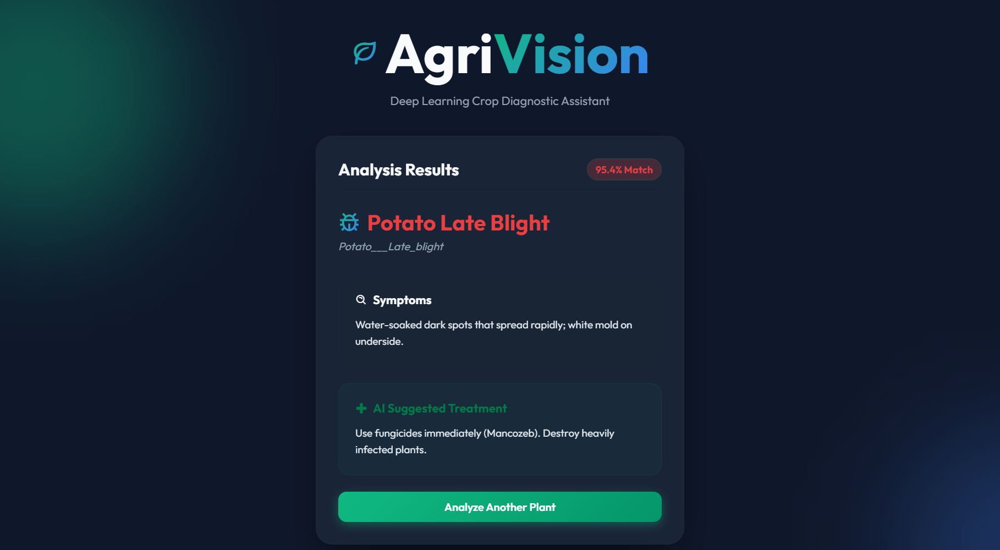
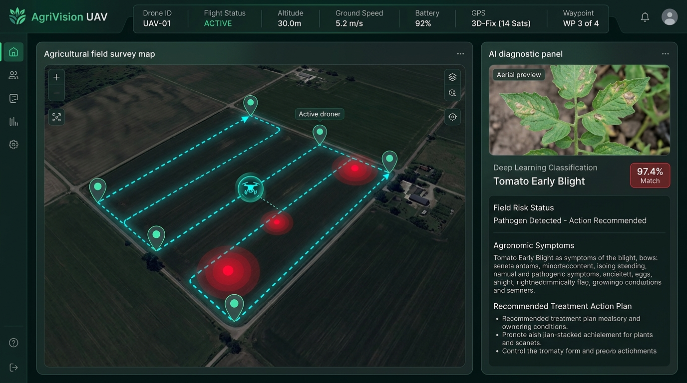

# 🌱 Agri-AI: Integrated Smart Crop Disease Detection & UAV Monitoring Platform

[](https://www.python.org/)
[](https://pytorch.org/)
[](https://fastapi.tiangolo.com/)
[](https://leafletjs.com/)
[](LICENSE)

**Agri-AI** is a unified, production-grade precision agriculture platform that integrates **PyTorch Deep Learning Foliar Pathology**, **Agronomic Farmer Advisory Prescriptions**, and **Simulated UAV Autonomous Drone Flight Surveillance** into a cohesive single-dashboard application.

The platform provides end-to-end plant diagnostic intelligence across **Tomato**, **Potato**, and **Bell Pepper (Capsicum)** crops with **99.3% validation accuracy**, automatically calculating disease lesion severity, generating verified treatment plans, and coordinating autonomous aerial drone missions to pinpoint and monitor infected field sectors in real time.

---

## 📱 Platform Previews

### 🌿 Unified Smart Agriculture Dashboard


### 🚁 Integrated Autonomous UAV Mission & GIS Satellite Mapping


---

## 🚁 Unified System Architecture

```text
                                 🌱 FARMER SPECIMEN UPLOAD
                              (Tomato, Potato, or Bell Pepper)
                                            │
                                            ▼
                        ┌───────────────────────────────────────┐
                        │     FastAPI Unified Diagnostic API    │
                        │             (POST /predict)           │
                        └───────────────────┬───────────────────┘
                                            │
                     ┌──────────────────────┴──────────────────────┐
                     ▼                                             ▼
       🧠 PYTORCH DEEP LEARNING                       🔍 LESION MORPHOMETRY
         (MobileNetV2 CNN)                             (Pixel Color Analysis)
     - Pathogen Classification                      - Severity Evaluation
     - Crop Identification                            (Healthy, Mild, Moderate, Severe)
     - 99.3% Diagnostic Accuracy                    - Confidence Percentage
                     │                                             │
                     └──────────────────────┬──────────────────────┘
                                            │
                                            ▼
                       📋 DEDICATED FARMER ACTION ADVISORY
         1. Immediate Field Actions          4. Irrigation & Fertilizer Management
         2. Organic & Bio-Control Remedies   5. Long-Term Crop Prevention
         3. Verified Treatment Methods       6. Expert Agronomist Thresholds
                                            │
                                            ▼
                    🚁 AUTONOMOUS UAV SIMULATION & GIS LINKAGE
         - Dynamic Waypoint Trajectory Generation around Affected Crop
         - Live Telemetry HUD: Altitude (AGL), Ground Speed, Battery, Sats
         - Interactive Leaflet.js Satellite GIS Map & Disease Hotspot Polygons
         - Real-time Mission Controls (Start, Pause, Complete, Reset)
         - Farmer Custom Field GPS Coordinate Entry
                                            │
                                            ▼
                        📜 PERSISTENT DETECTION & MISSION AUDIT
               (Thumbnails, Crop, Disease, Severity, Sector, Drone Status)
```

---

## ✨ Core Platform Capabilities

### 1. 🌿 Multi-Crop Disease Detection (Tomato, Potato, Bell Pepper)
- **High-Precision Neural Classifier:** Fine-tuned MobileNetV2 architecture with transfer learning.
- **Supported Crops:**
  - **Tomato:** Early Blight (*Alternaria solani*), Late Blight (*Phytophthora infestans*), Bacterial Spot (*Xanthomonas*), Leaf Mold (*Fulvia fulva*), Healthy.
  - **Potato:** Early Blight (*Alternaria solani*), Late Blight (*Phytophthora infestans*), Healthy.
  - **Bell Pepper (Capsicum):** Bacterial Spot (*Xanthomonas euvesicatoria*), Healthy (*Capsicum annuum*).
- **Dynamic Lesion Severity Estimation:** Calculates necrotic-to-healthy leaf surface area ratio to classify severity into **Healthy**, **Mild**, **Moderate**, or **Severe**.
- **Confidence Threshold Guard (70%+):** Detects low-confidence or non-crop foliage and prompts the farmer to take clearer photographs.

### 2. 👨‍🌾 Farmer-Friendly Treatment Recommendations
For every detected pathogen, the platform provides tailored, actionable advice across **6 structured agronomic categories**:
1. **Immediate Actions:** Emergency containment steps (e.g. leaf removal, sanitizing tools, withholding overhead watering).
2. **Organic Options:** Certified organic and biological deterrents (*Bacillus subtilis*, copper octanoate, neem extracts).
3. **Recommended Treatment Methods:** Verified application techniques and protective sprays following manufacturer labels (never guessing chemical dosages).
4. **Irrigation & Fertilizer Management:** Tailored water and nutrient guidance (drip irrigation, potassium support, avoiding excessive nitrogen).
5. **Prevention Techniques:** Multi-year solanaceous crop rotation, certified seed stock, spacing, and plastic mulching.
6. **When to Consult an Expert:** Clear threshold triggers (e.g., foliage collapse >15% within 48 hours) for visiting local extension services or Krishi Vigyan Kendras.

### 3. 🚁 Integrated UAV Drone Mission Simulation (Unified with AI Diagnosis)
- **Automatic Mission Coupling:** As soon as a disease is detected from an uploaded image, the system automatically builds an aerial flight path centered on the affected crop plot.
- **Flight Telemetry HUD:** Real-time simulated telemetry displaying altitude (AGL), ground speed, battery consumption, heading angle, signal strength, and 3D satellite lock.
- **Interactive Leaflet GIS Mapping:** High-resolution dark satellite tiles, research farm boundaries, home recovery base, waypoint flight paths, and pulsing disease hotspot alert polygons.
- **Mission Control State Machine:** Complete interactive flight controls to **Start Mission**, **Pause Mission**, **Complete Mission**, and **Reset UAV to Base Pad**.
- **Farmer Custom Field Coordinates:** If farmers want to survey their own physical fields, they can select predefined sectors or enter exact custom GPS coordinates.
- **Dual View Support:** Full monitoring is unified directly below the diagnosis on the homepage, while the dedicated `/drone` control view remains fully functional and synchronized.

### 4. 📊 Detection History & Audit Ledger
- Complete visual audit trail of all field inspections.
- Tracks specimen image thumbnail, crop species, disease name, severity rating, confidence score, field sector code, timestamp, and drone survey status.
- Search and clear actions to manage farm diagnostic logs.

---

## 🛠️ Technology Stack

| Layer | Technologies |
|---|---|
| **Deep Learning & Computer Vision** | PyTorch, TorchVision, MobileNetV2, Pillow, NumPy, Scikit-learn |
| **Backend Framework** | FastAPI, Uvicorn, Python-Multipart, Pydantic |
| **GIS & Mapping** | Leaflet.js, OpenStreetMap / CARTO Dark Matter Tiles |
| **Frontend UI/UX** | HTML5, CSS3 Glassmorphism, Vanilla ES6+ JavaScript, Boxicons |
| **Dataset Source** | PlantVillage Dataset (Solanaceous Crops: Tomato, Potato, Bell Pepper) |

---

## 📂 Project Architecture

```text
Leaf-Disease-AI/
│
├── assets/
│   ├── uav_dashboard_preview.png  # 🚁 UAV autonomous mission & GIS map screenshot
│   └── sample_output.png          # 📱 Unified diagnostic dashboard screenshot
│
├── drone_simulator.py             # 🚁 [UAV Engine] Dynamic flight trajectory & telemetry generator:
│                                  #    - Dynamic waypoint generator centered on detected crop
│                                  #    - Telemetry HUD: GPS, altitude, speed, battery drain
│                                  #    - Field sector mapping (Sectors A through E + Custom GPS)
│                                  #    - Mission state machine (Start, Pause, Complete, Reset)
│
├── main.py                        # ⚡ [FastAPI Backend Engine] Integrated REST endpoints:
│                                  #    - GET  /               : Unified Smart Agriculture dashboard
│                                  #    - GET  /drone          : Dedicated UAV flight control view
│                                  #    - POST /predict        : AI diagnosis + automatic drone mission binding
│                                  #    - GET  /drone/mission   : Synchronized flight waypoints & target
│                                  #    - GET  /drone/telemetry : Real-time flight telemetry stream
│                                  #    - POST /drone/mission/* : Mission lifecycle controls
│                                  #    - GET  /history        : Detection history ledger
│
├── model/                         # 🧠 [Deep Learning Core]
│   ├── disease_model.pth          #    - Fine-tuned MobileNetV2 PyTorch weights
│   ├── inference.py               #    - Multi-crop classifier, lesion severity estimator & threshold guards
│   └── disease_info.json          #    - Etiology, symptoms, and 6-part farmer recommendations for 10 classes
│
├── static/                        # 🎨 [Modern Agricultural Frontend]
│   ├── index.html                 #    - Single unified dashboard (Overview, Diagnosis, Actions, UAV, History)
│   ├── style.css                  #    - Agricultural theme (light green, dark green, white, glass cards)
│   ├── app.js                     #    - Real-time UI logic, preset tester, Leaflet GIS, and flight animation
│   ├── drone.html                 #    - Dedicated UAV ground control station view
│   ├── drone.css                  #    - Dedicated drone HUD styling
│   ├── drone.js                   #    - Dedicated drone telemetry scripts
│   └── uploads/                   #    - Saved specimen images for history and audit
│
├── test_suite.py                  # 🧪 Comprehensive 43-point automated integration test suite
├── train.py                       # 🏋️ Model training pipeline
└── requirements.txt               # 📦 Project dependencies
```

---

## 🚀 Quick Start Guide

### 1. Clone & Set Up Environment
```bash
git clone https://github.com/NitanGanutra/Leaf-Disease-AI.git
cd Leaf-Disease-AI

# Create and activate virtual environment
python -m venv .venv
# Windows:
.\.venv\Scripts\activate
# Linux/macOS:
source .venv/bin/activate

# Install dependencies
pip install -r requirements.txt
```

### 2. Run the Automated Test Suite
```bash
python test_suite.py
```
*Expected output: `43/43 TESTS PASSED (100% SUCCESS)`*

### 3. Launch the Unified Platform
```bash
python main.py
# Or launch directly with uvicorn:
uvicorn main:app --host 127.0.0.1 --port 8000 --reload
```

### 4. Open in Your Browser
- **Unified Smart Agriculture Dashboard:** [http://localhost:8000/](http://localhost:8000/)
- **Dedicated UAV Ground Station View:** [http://localhost:8000/drone](http://localhost:8000/drone)

---

## 🌾 Supported Crops and Diagnostic Classes

| Index | Crop | Condition Name | Pathogen / Type | Default Severity |
|---|---|---|---|---|
| 0 | Potato | Potato Early Blight | *Alternaria solani* (Fungal) | Moderate |
| 1 | Potato | Potato Late Blight | *Phytophthora infestans* (Oomycete) | Severe |
| 2 | Potato | Healthy Potato | Optimal Plant Vigor | Healthy |
| 3 | Tomato | Tomato Bacterial Spot | *Xanthomonas spp.* (Bacterial) | Moderate |
| 4 | Tomato | Tomato Early Blight | *Alternaria solani* (Fungal) | Moderate |
| 5 | Tomato | Tomato Late Blight | *Phytophthora infestans* (Oomycete) | Severe |
| 6 | Tomato | Tomato Leaf Mold | *Fulvia fulva* (Fungal) | Moderate |
| 7 | Tomato | Healthy Tomato | Optimal Plant Vigor | Healthy |
| 8 | Bell Pepper | Bell Pepper Bacterial Spot | *Xanthomonas euvesicatoria* (Bacterial) | Moderate |
| 9 | Bell Pepper | Healthy Bell Pepper | *Capsicum annuum* (Optimal Vigor) | Healthy |

---

## 💡 Practical Agronomic Disclaimer
All agronomic treatments, biological controls, and chemical recommendations provided by Agri-AI are designed for educational, research, and advisory support. Any chemical pesticides or fungicides mentioned must strictly follow certified product-label instructions and local agricultural extension regulations. Farmers should consult certified agronomy experts before applying extensive chemical interventions.
